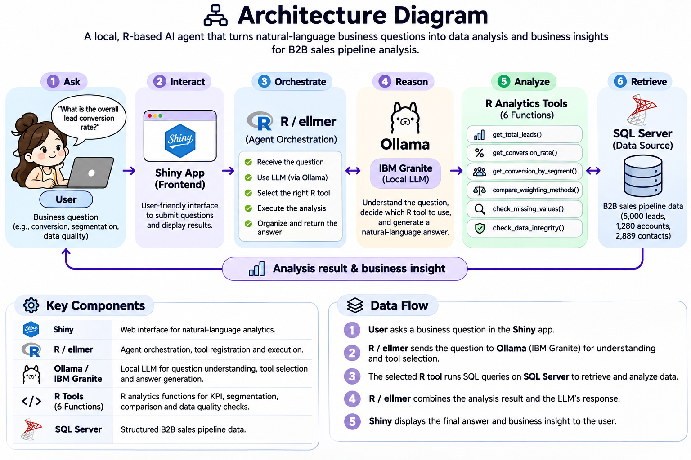
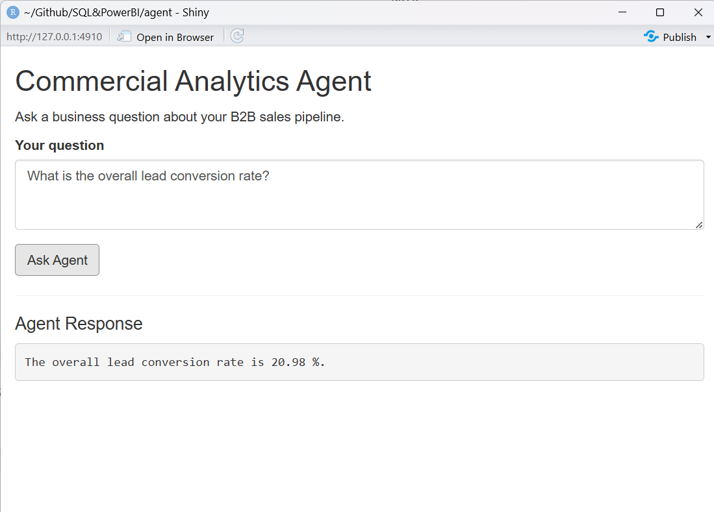
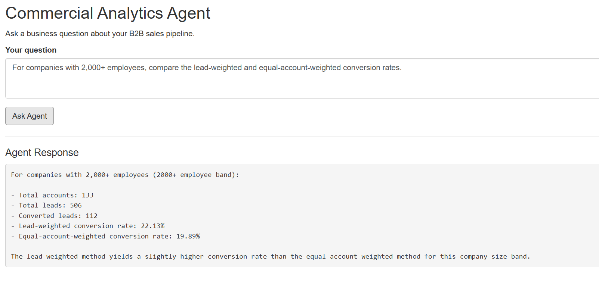
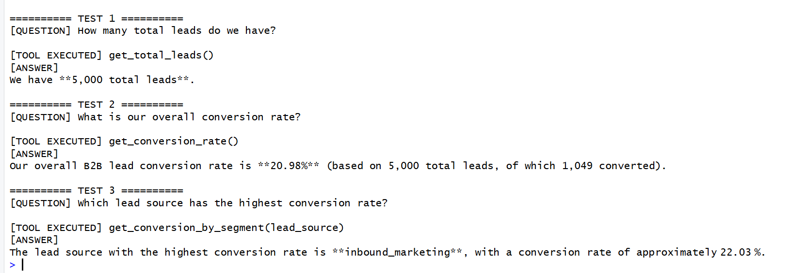
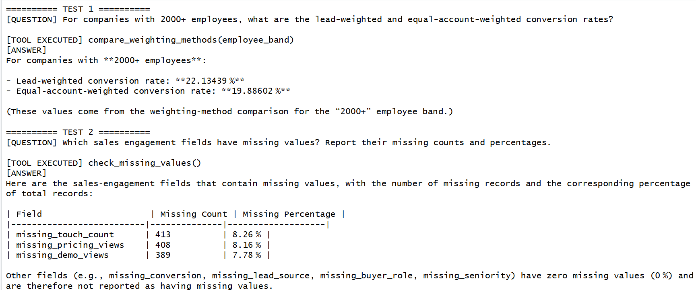

# Commercial Analytics AI Agent

A local AI Agent for B2B sales pipeline analytics, built with R, SQL Server, IBM Granite, Ollama, ellmer, and Shiny.

## Project Overview

This project explores how a local Large Language Model (LLM) can interact with structured sales data through predefined analytical tools.

Instead of asking the LLM to calculate business metrics from memory, the Agent uses R functions to query SQL Server and return data-grounded answers.

The application provides a Shiny interface for natural-language questions about sales pipeline performance, customer conversion, segmentation, and data quality.


## System Architecture

The Agent uses R and ellmer to register and orchestrate analytical tools, while IBM Granite runs locally through Ollama for natural-language understanding and tool selection.

Six predefined R analytics functions query SQL Server. The query results return through the R/ellmer workflow and are used to generate data-grounded answers displayed in Shiny.



## Demo

### 1. Natural-Language Sales Analytics

The Agent answers business questions through a Shiny interface using predefined SQL-backed R functions.



### 2. Business KPI Comparison

For companies with 2,000+ employees:

- Total accounts: 133
- Total leads: 506
- Converted leads: 112
- Lead-weighted conversion rate: 22.13%
- Equal-account-weighted conversion rate: 19.89%

The 2.24-percentage-point difference demonstrates how weighting methods affect business KPI interpretation.



### 3. Tool Calling and Validation

Integration tests demonstrate tool selection and execution for different natural-language business questions.



Additional tests cover missing-value assessment and lead/account identifier integrity.



## Core Capabilities

Six analytical tools are implemented:

1. Total lead count
2. Overall lead conversion rate
3. Conversion analysis by selected segments
4. Lead-weighted versus equal-account conversion comparison
5. Missing-value assessment
6. Lead and account identifier integrity checks

Tool inputs are constrained through predefined parameters rather than unrestricted SQL generation.

## Technology Stack

- R — analytical functions and Agent orchestration
- SQL Server — structured B2B pipeline data
- DBI and odbc — database connectivity
- ellmer — LLM integration and tool calling
- Ollama — local model inference
- IBM Granite 4.2 3B — local LLM
- Shiny — interactive user interface

## Data Source and SQL Dependencies

This Agent extends my [B2B Sales Pipeline Intelligence](https://github.com/Irene-sketch104/b2b-sales-pipeline-intelligence) project, which covers SQL Server data preparation, KPI reporting, and Power BI analysis using synthetic B2B sales pipeline data.

The Agent requires three compatible SQL Server views:

- `analytics.vw_leads_reporting`
- `analytics.vw_accounts`
- `analytics.vw_account_metrics`

Please refer to the linked repository for the underlying data analytics project. The Agent-specific views must be available in the local SQL Server database.

## Local Setup

### Prerequisites

- R and RStudio
- SQL Server with the required analytical views
- Microsoft ODBC Driver 18 for SQL Server
- Ollama with the `granite4.2:3b` model
- R packages: `DBI`, `odbc`, `ellmer`, `shiny`

Install the R packages if needed:

```r
install.packages(c("DBI", "odbc", "ellmer", "shiny"))
```

Download the local model:

```bash
ollama pull granite4.2:3b
```

### Database Connection

Copy `02_connection.example.R` to `02_connection.R` and configure your SQL Server connection.

The actual local connection file is excluded from Git version control. The provided example uses Windows authentication and development-oriented TLS settings; production deployments should use appropriately secured database connections.

### Running the Application

1. Ensure SQL Server is accessible and the required views exist.
2. Ensure Ollama is running and `granite4.2:3b` is available.
3. Open `agent.Rproj` in RStudio.
4. Open `07_app.R` and run the application using RStudio.

## Testing and Validation

The local agent has been tested with:

- Six registered SQL-backed analytics tools
- Natural-language questions requiring different tool selections
- Cross-level conversion metrics
- Missing-value and identifier integrity checks
- Unsupported questions where the Agent should avoid inventing unavailable metrics
- Repeated requests and empty-input handling

Tests were performed locally against synthetic B2B pipeline data. This is a portfolio prototype, not a deployed production service.

## Project Scope

This project focuses on integrating a local LLM with reliable, predefined business analytics tools.

The current version does not provide autonomous database modification, arbitrary SQL generation, production hosting, or general-purpose forecasting.

## Related Project

[B2B Sales Pipeline Intelligence — SQL Server & Power BI](https://github.com/Irene-sketch104/b2b-sales-pipeline-intelligence)
